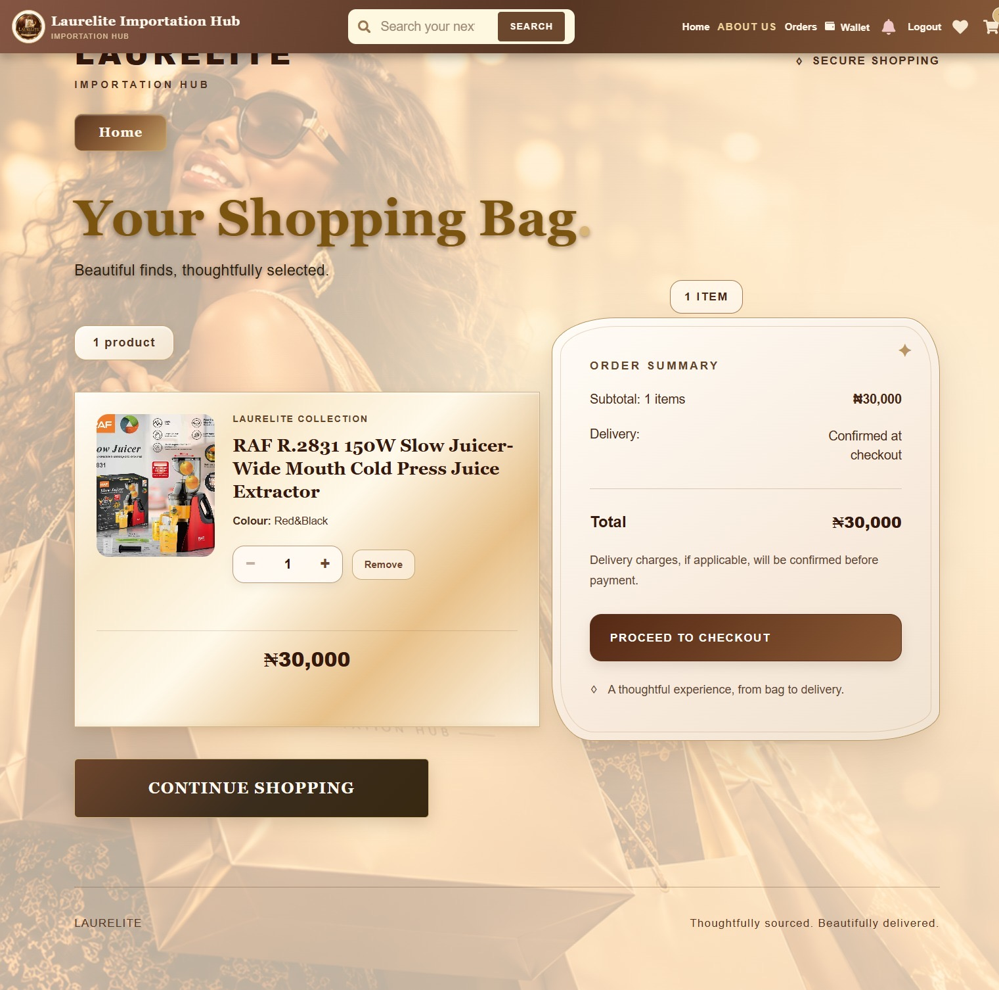
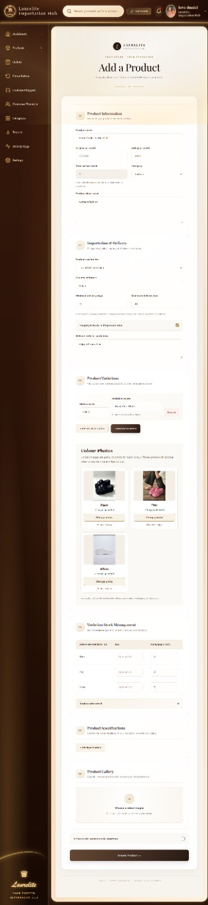
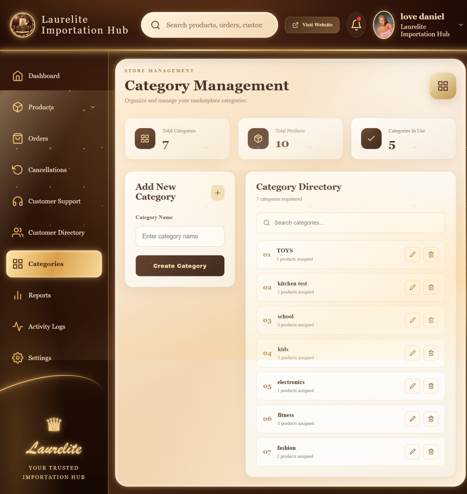
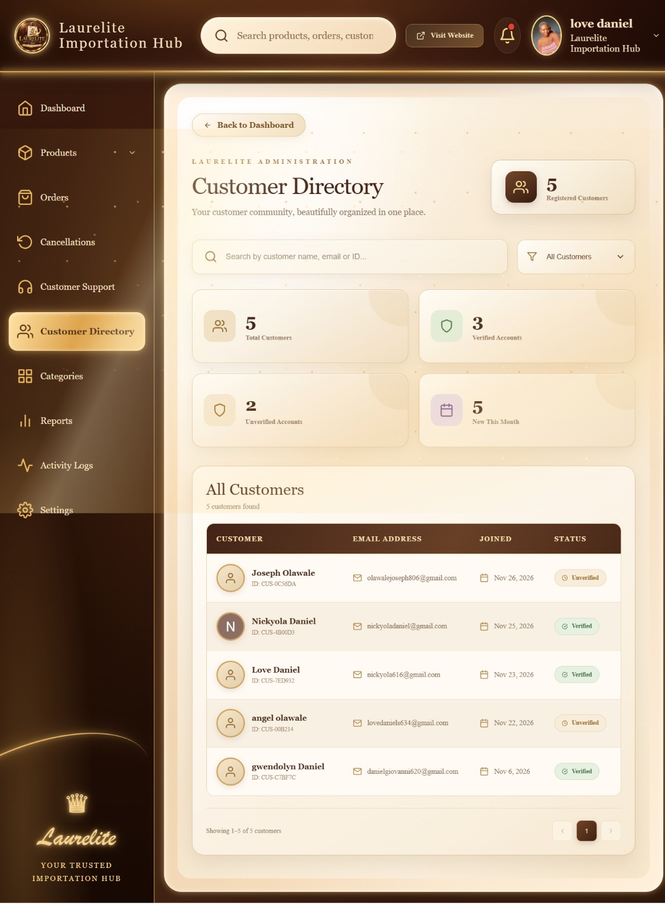
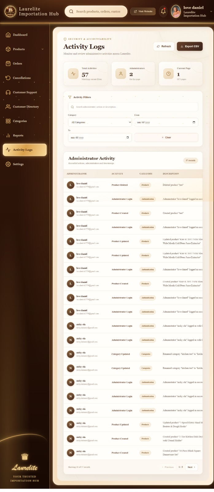
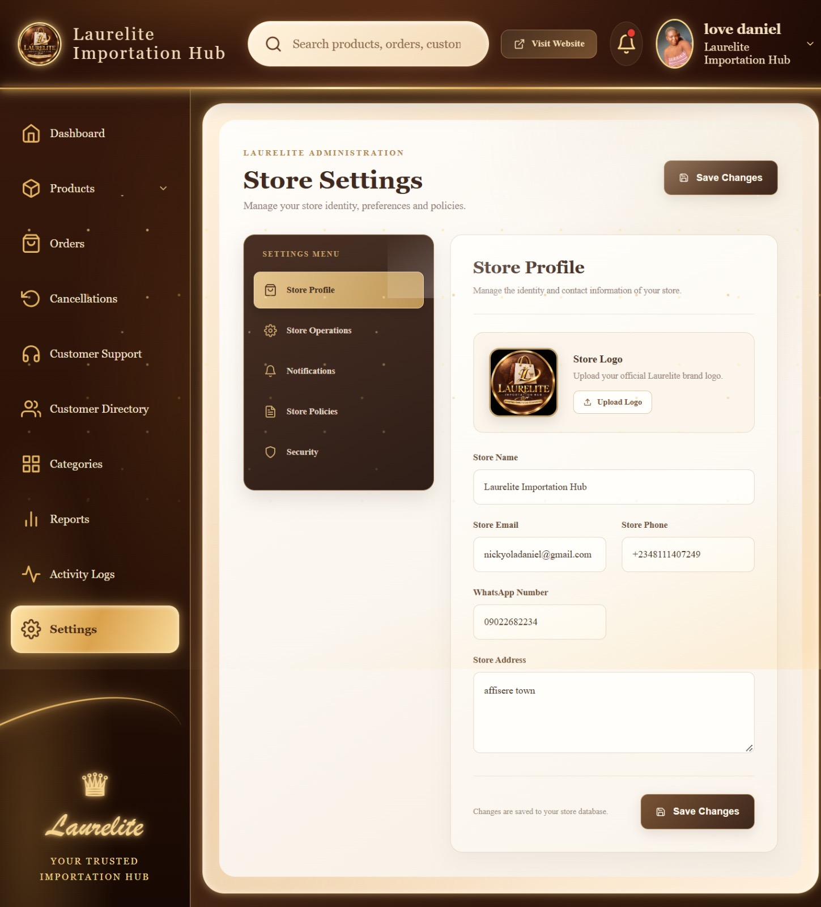

Chapter 2: Business Requirements and Functional Features

← Back to Main README

2.1 Introduction

This chapter describes the business requirements and functional features that guided the development of Laurelite Importation Hub.

Before building the application, I needed to identify what the platform should achieve, who would use it and what functionality would make the shopping experience practical.

The requirements cover customer activities, administrative operations, payment processing, order management and the platform’s planned marketplace expansion.

2.2 Business Requirements

The primary business requirement was to develop an e-commerce platform where customers could browse products, manage their shopping activities, complete payments and monitor their orders.

The platform also needed administrative functionality to manage its operations without requiring direct database intervention for routine tasks.

The system was designed around the following requirements:

* Provide a convenient online shopping experience.
* Allow customers to create and manage accounts.
* Support product discovery and shopping cart operations.
* Provide secure payment options.
* Support customer wallet transactions.
* Manage orders, cancellations and refunds.
* Provide administrative oversight.
* Maintain a responsive interface across different screen sizes.
* Establish a foundation for future marketplace expansion.

2.3 Customer Functional Requirements

Customers are the primary users of the shopping platform.

The customer-facing application includes the following functionality.

2.3.1 User Registration and Authentication

Customers can:

* Create an account.
* Verify their email address using an OTP.
* Sign in using their registered credentials.
* Authenticate using Google.
* Recover forgotten passwords.
* Reset passwords using the verification process.

2.3.2 Product Discovery

Customers can:

* Browse available products.
* Explore product categories.
* Search for products.
* View individual product details.
* View product images, prices and available information.
* Explore featured products.

*Figure 2.1: Laurelite Product Catalogue and Featured Product Listings.*

2.3.3 Shopping Cart

The shopping cart allows customers to:

* Add products to their cart.
* View selected products.
* Update product quantities.
* Remove products.
* Review cart totals before checkout.

*Figure 2.2: Customer Shopping Cart and Order Summary.*

2.3.4 Wishlist

Customers can save products they are interested in and manage their wishlist from their accounts.

2.3.5 Checkout and Payments

The checkout process allows customers to:

* Provide delivery information.
* Review their order.
* Select an available payment method.
* Complete payments through the integrated payment system.
* Receive payment confirmation and order information.

2.3.6 Customer Wallet

The wallet functionality allows customers to:

* View their wallet balance.
* Fund their wallet.
* Verify wallet funding transactions.
* Use their wallet to pay for eligible orders.
* View wallet transaction history.
* Receive wallet credits from supported refund processes.

2.3.7 Orders and Delivery

Customers can:

* View their orders.
* Access individual order details.
* Monitor order status.
* View available delivery and tracking information.
* Submit cancellation requests where applicable.

2.3.8 Reviews and Ratings

The product data structure supports customer reviews and ratings, allowing product feedback to be associated with products.

2.3.9 Notifications and Customer Support

The application includes notification and support functionality to help customers stay informed and communicate with the platform’s administrators.

2.3.10 Profile Management

Customers can manage relevant account information, including:

* Personal details.
* Contact information.
* Profile image.
* Delivery addresses.
* Other available account preferences.

2.4 Administrative Functional Requirements

The administrative section provides tools for managing the platform’s operations.

2.4.1 Dashboard

The administrator has access to a dashboard for viewing relevant platform information and operational activities.

2.4.2 Product Management

Administrative product operations include:

* Creating products.
* Updating product information.
* Editing product details.
* Managing product availability.
* Managing product categories.

*Figure 2.3: Administrative Product Creation Interface.*

*Figure 2.4: Administrative Category Management Interface.*

2.4.3 Customer Management

Administrators can access customer management functionality and view relevant customer information.

*Figure 2.5: Administrative Customer Directory.*
2.4.4 Order Management

The administrative system supports:

* Viewing customer orders.
* Accessing order details.
* Managing order status.
* Reviewing cancellation requests.
* Managing delivery-related information.

2.4.5 Refund Management

The platform provides administrative functionality for handling supported refund methods, including Paystack refunds, manual refunds and wallet refunds.

2.4.6 Wallet Management

Administrative wallet functionality includes:

* Viewing customer wallets.
* Reviewing wallet balances.
* Accessing wallet transaction history.
* Making authorised wallet adjustments with supporting reasons.

2.4.7 Reports and Activity Records

The administrative system includes reporting functionality and activity records to support operational oversight.

*Figure 2.6: Administrative Activity Logs and Operational Records.*

2.4.8 Support and Store Settings

Administrators can access customer support management and store configuration functionality.

*Figure 2.7: Administrative Store Settings and Configuration.*

2.5 Seller and Multi-Vendor Requirements

A major part of the long-term business direction is to expand the platform into a multi-vendor marketplace.

The intended seller functionality includes:

* Seller registration.
* Seller account approval.
* Seller-specific dashboards.
* Product listing and management.
* Seller order management.
* Sales and earnings information.
* Commission calculations.
* Seller account permissions.

The current application contains preliminary seller-related groundwork, including an isSeller field. However, this does not represent a fully operational seller management system.

The complete seller registration, approval, permissions and dashboard workflows remain part of future development.

2.6 China Sourcing and Preorder Business Requirements

Another part of my business vision is to make shopping from China easier for Nigerian customers.

The intended model involves connecting customers with Nigerian preorder agents already operating in China.

The objective is to improve access to products sourced from China while offering competitive prices that are as close as possible to the original 1688 pricing.

Future development in this area may include:

* China-sourced product listings.
* Preorder product information.
* Agent-related workflows.
* Order coordination.
* Estimated delivery information.
* Customer preorder tracking.

These are business expansion requirements and should not be confused with already implemented preorder-agent management functionality.

2.7 Non-Functional Requirements

Beyond the features customers and administrators interact with, the platform also needed to satisfy important technical requirements.

2.7.1 Responsiveness

The frontend should adapt to different screen sizes, including mobile phones, tablets and desktop devices.

2.7.2 Usability

The application should provide clear navigation, understandable actions and a consistent shopping experience.

2.7.3 Security

Sensitive operations should be protected through authentication, authorisation, password hashing, environment-based secrets and payment verification.

2.7.4 Reliability

Payment, wallet and order operations should include appropriate validation and safeguards against duplicate transactions.

2.7.5 Maintainability

The application should use organised frontend and backend structures to make debugging, updates and future development easier.

2.7.6 Scalability

The architecture should provide a foundation for future expansion. Actual capacity and performance at larger traffic levels will require continued testing and infrastructure improvements.

2.7.7 Compatibility

The application should support modern browsers and commonly used devices.

2.8 Summary

The business requirements established the direction for the development of Laurelite Importation Hub.

They helped define the customer experience, administrative functionality, payment infrastructure and technical expectations of the platform.

They also provided a foundation for future development, particularly the expansion into a multi-vendor marketplace and China sourcing business.

⸻

← Previous: Project Overview | Back to Main README | Next: System Architecture
